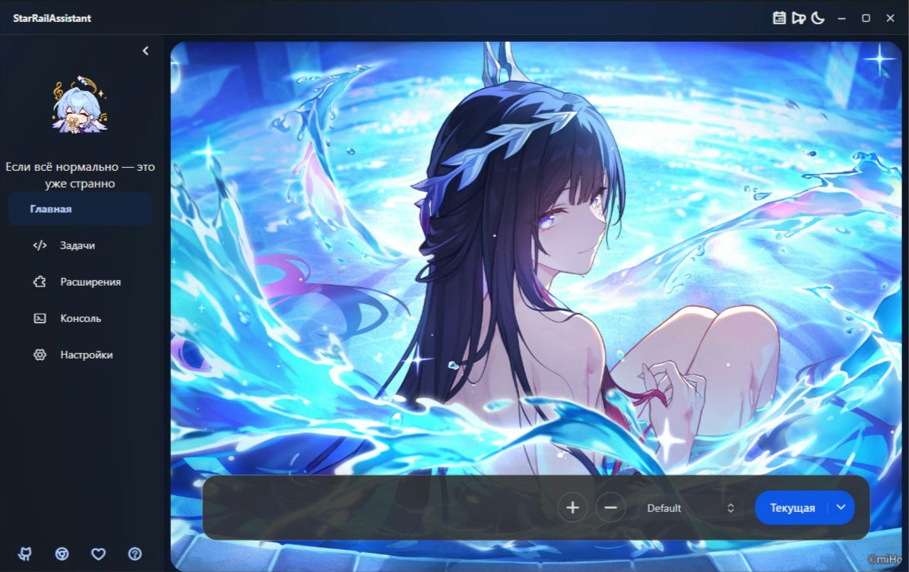

    
    
    
    
    

<a href="https://starrailassistant.top"><b>Сайт оригинала</b></a> | <a href="README.ru.md"><b>Русский</b></a> | <a href="README.en.md"><b>English</b></a> | <a href="README.zh.md"><b>中文</b></a>

#### [Решение проблем](docs/TROUBLESHOOTING.ru.md) | [FAQ оригинала](https://starrailassistant.top/getting-started/faq/) | [Скачать](https://github.com/sososos662/StarRailAssistant-RU/releases) | [Инструкция](README_RU.md)

# 🌟 StarRailAssistant (SRA)

🎮 Помощник для автоматизации **Honkai: Star Rail**.
Если при использовании возникли проблемы, сначала загляните в [руководство по их решению](docs/TROUBLESHOOTING.ru.md).

Если проект вам полезен, поддержите его звёздочкой ⭐!

Это русскоязычный форк [Shasnow/StarRailAssistant](https://github.com/Shasnow/StarRailAssistant)
на базе **v2.25.0-beta.1**. Ниже — перевод README оригинального проекта с дополнениями нашего форка.

## ❓ Что такое SRA?

🤖 Программа на основе распознавания изображений, которая помогает выполнять
повседневные задачи в Honkai: Star Rail — от запуска игры до выхода из неё.

## Что добавлено и улучшено в форке

- **Русский интерфейс:** настольная программа, WebUI, консоль и описания настроек;
  исправлены отображение кириллицы и обмен текстом между компонентами.
- **Исправления CurrencyWarsPlus:** работа магазина и состава, восстановление
  после переходов, распознавание финала SSS и итогового здоровья.
- **Оптимизация распознавания:** ускорены отдельные проверки страниц, магазина
  и задней линии без изменения правил стратегии.
- **DirectML OCR:** распознавание через видеокарту и резервный CPU-режим.
- **Диагностика:** кадры неполной витрины, раздельные тайминги и сведения об OCR-провайдерах.
- **«Химэко Нова (Европа)»:** включён [вариант стратегии для Europe/Global](extensions/cw_plus/strategies/himeko_global_europe_20261026.json)
  с сохранённым игровым кодом и неизменными правилами покупок, состава и экономики.

Сам CurrencyWarsPlus и его штатные стратегии уже были в оригинале.
Подробности наших изменений: [FORK.md](FORK.md) и [CHANGELOG_RU.md](CHANGELOG_RU.md).

## ⚠️ Отказ от ответственности

SRA — внешний инструмент для автоматизации Honkai: Star Rail. Он взаимодействует
с игрой через обычный пользовательский интерфейс и не изменяет игровые файлы или код.
Программа не предназначена для нарушения игрового баланса или получения нечестного преимущества.

Проект открыт и бесплатен, предназначен для обучения и обмена опытом.
Разработчики не несут ответственности за проблемы и последствия его использования.
Если кто-то берёт оплату за прохождение с помощью SRA, это не делает такую услугу
частью проекта: плата может относиться к оборудованию, времени исполнителя и другим расходам.

В [заявлении miHoYo о честной игре](https://sr.mihoyo.com/news/111246?nav=news&type=notice) указано:

> Запрещено использование читов, ускорителей, скриптов и других сторонних инструментов,
> нарушающих принципы честной игры. В зависимости от тяжести и числа нарушений возможны
> изъятие полученных преимуществ, временная заморозка или постоянная блокировка аккаунта.

## ✨ Возможности

* 🎯 **Запуск игры**
  * Укажите путь к игре, логин и пароль — программа выполнит запуск и вход.
    В оригинале также поддерживается китайская версия Bilibili.
* ⚡ **Расходование энергии Освоения**
  * Выбирайте уровни, количество и порядок прохождений. Поддерживается подбор
    уровней и числа попыток по целям развития персонажей.
* 🎁 **Получение наград**
  * Ежедневная тренировка, Честь Безымянных, поддержка, промокоды, поручения,
    награды за вход, почта и другие источники.
* 🚀 **Очки Расходящейся вселенной**
  * Автоматическое получение очков до недельного лимита, остановка по его достижении
    и сбор соответствующих наград.
* 🎲 **Валютные войны**
  * Автоматизация обычного режима и разгона; победа на максимальной сложности не гарантируется.
  * Подбор старта по инвестиционной среде, инвестиционной стратегии, имени и модификаторам босса.
* 🚪 **Выход из игры**
  * При желании — закрытие SRA и выключение компьютера.
* 📖 **Автоматические диалоги**
  * Просмотр сюжета без ручного пролистывания; поддерживается пропуск.
* 🔄 **Переключение между аккаунтами**
* ☁️ **Облачная Honkai: Star Rail**
  * Поддержка китайской облачной версии игры с работой в фоне.

## ⚠️ Настройки перед запуском

* 🌐 **Язык игры:** упрощённый китайский — **简体中文**. Интерфейс самого помощника может быть русским.
* 📺 **Разрешение:**
  * Если разрешение экрана **выше 1080p**, используйте игру в **оконном режиме 1920×1080**.
  * Если разрешение экрана **равно 1080p**, используйте **полноэкранный режим 1920×1080**.
    Иначе распознавание может работать неправильно.
* 🖱️ **Во время выполнения задач не используйте мышь и клавиатуру для других действий.**

## 🚀 Как начать пользоваться SRA?

⬇️ **[Скачать готовую программу для Windows x64](https://github.com/sososos662/StarRailAssistant-RU/releases/download/v2.25.0-beta.1-ru.20261028.1/StarRailAssistant_v2.25.0-beta.1_RU.zip)** ·
[Все релизы форка](https://github.com/sososos662/StarRailAssistant-RU/releases)

В нашей сборке **всё уже подготовлено**: отдельно устанавливать Python или .NET не нужно.

1. Скачайте `StarRailAssistant_v2.25.0-beta.1_RU.zip`, распакуйте в удобную папку и запустите **`SRA.exe`**.
2. Откройте **Настройки → Отображение → Язык → Русский** и подтвердите перезапуск.
3. Выберите нужные задачи или расширение и настройте их перед запуском.

* **WebUI** уже включён в полную сборку и доступен после запуска `SRA-server.exe`.
* Для **«Валютных войн Plus»** откройте **Расширения → Валютные войны Plus → Настройки**:
  укажите имя Первопроходца, выберите стратегию и параметры игры.
* Подробная инструкция: [README_RU.md](README_RU.md).
  Запуск из исходников и сборка: [руководство](docs/BUILDING.ru.md).

## 🐛 Нашли ошибку?

Мы не можем обещать, что код всегда работает идеально — для этого и существуют **Issues**.

* 📝 Ошибки и предложения по русской версии: **[Issues этого форка](https://github.com/sososos662/StarRailAssistant-RU/issues)**.
* 📝 Оригинальный проект: [Issues StarRailAssistant](https://github.com/Shasnow/StarRailAssistant/issues).
* 📧 Почта команды оригинала: <yukikage@qq.com>.
* 💬 Тестовая QQ-группа оригинального проекта: **994571792**. Там можно:
  * узнавать о новых версиях;
  * делиться отзывами и предложениями;
  * общаться с разработчиками, знакомыми с Python, Java, C/C++, SQL, C#, Go,
    Vue, HTML, JavaScript, CSS и TypeScript;
  * обсудить магию дружбы с Сумеречной Искоркой;
  * бездельничать вместе с Цинцюэ;
  * ощутить заботу нежной кошкодевочки;
  * получить психологическую поддержку от Юмэмидзуки Мидзуки.

## 🤝 Как помочь проекту

Прочитайте [руководство для участников](CONTRIBUTING.md).

---

## 🙏 Участники

Спасибо **Shasnow**, **YukkiSSYB** и всем участникам оригинального проекта!
Их авторство и лицензия **[AGPL-3.0-or-later](LICENSE)** сохранены.

## ⭐ История звёзд оригинального проекта

